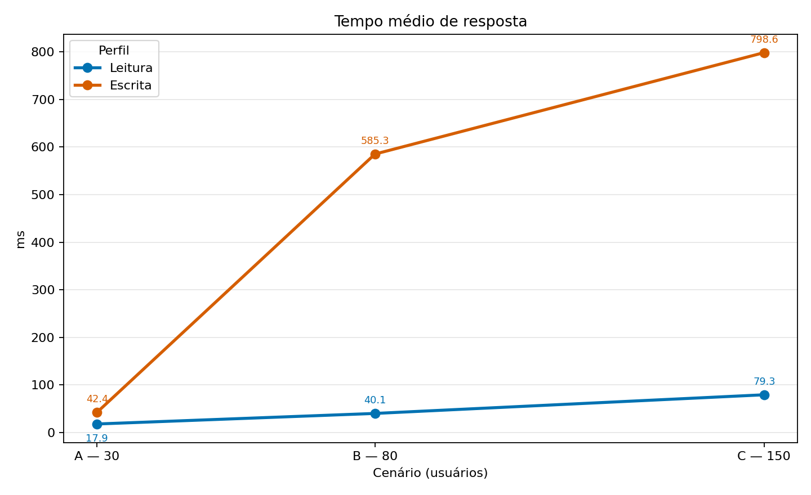
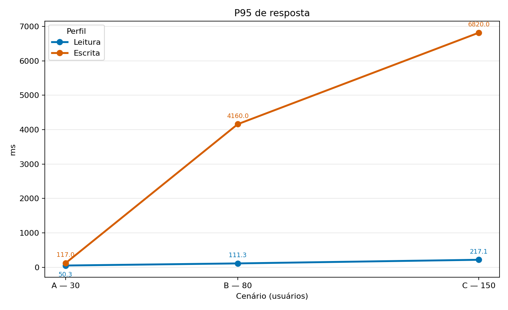
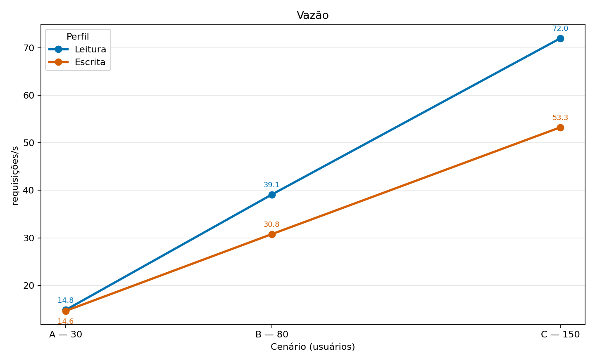
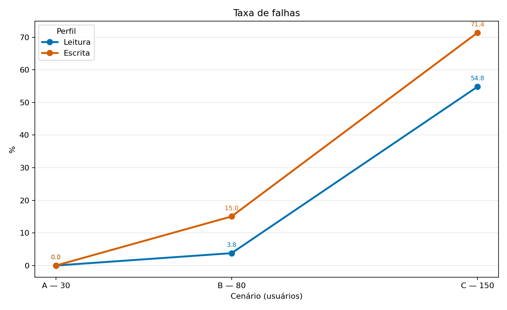
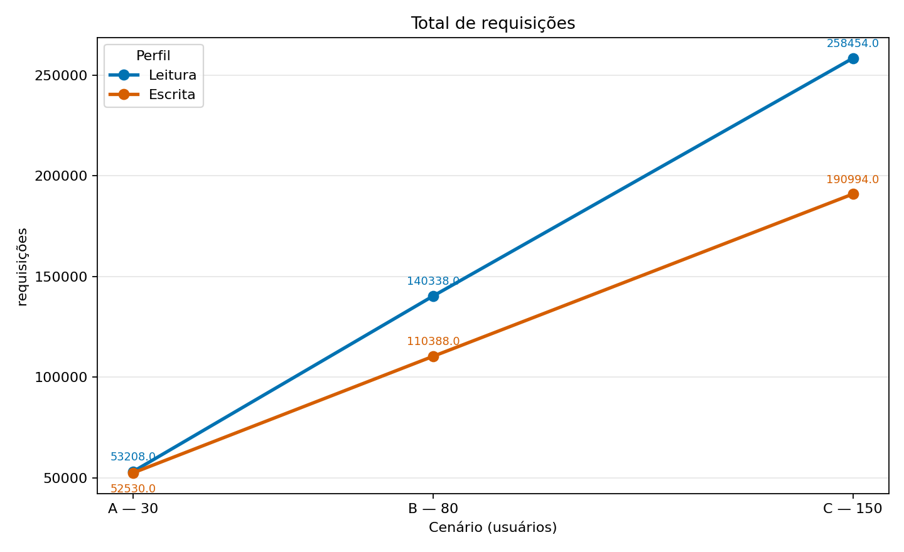
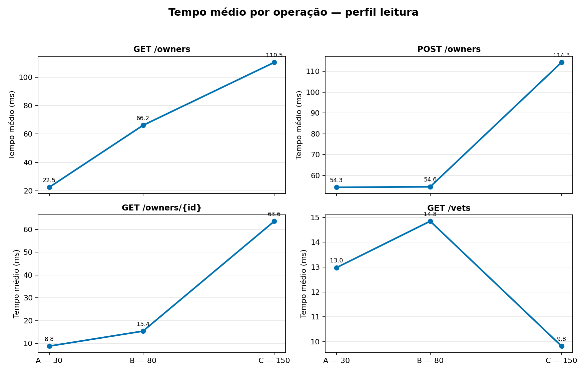
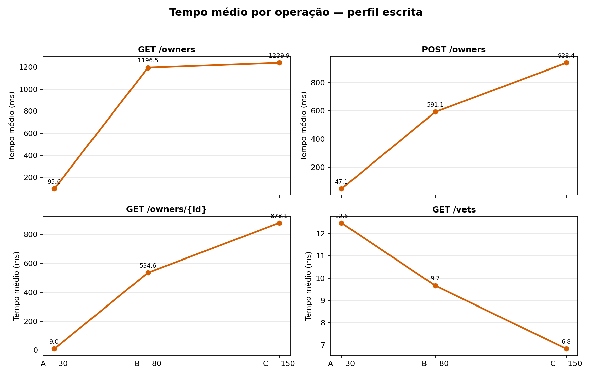
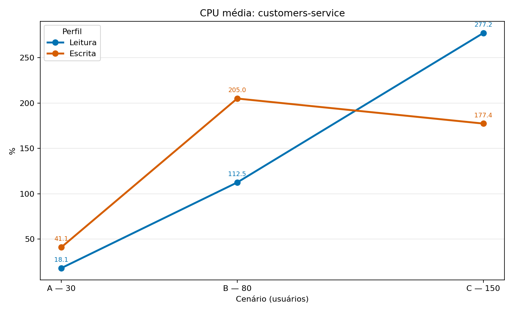
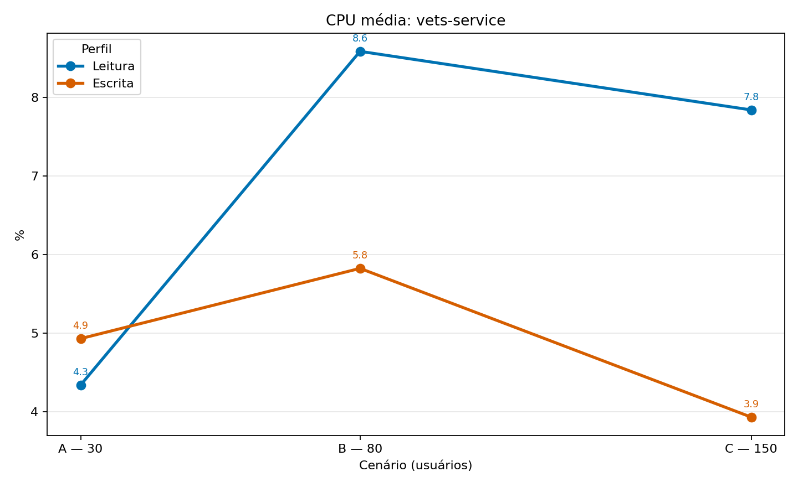

# Trabalho Prático 06 — Avaliação de Desempenho de Microsserviços com Locust

Avaliação de desempenho do [Spring PetClinic Microservices](https://github.com/spring-petclinic/spring-petclinic-microservices) com o Locust. O experimento compara dois perfis de carga, em três níveis de concorrência, medindo latência, vazão, falhas e utilização de CPU.

## Organização do repositório

```text
src/
├── locustfile.py             # Perfis e tarefas do Locust
├── executar_testes.py        # Orquestra as 60 execuções e coleta métricas
└── analisar_resultados.py    # Consolida CSVs e gera tabelas e gráficos
results/
├── execucoes.csv             # Registro das execuções realizadas
├── raw/                      # CSVs do Locust, logs e amostras do Docker
├── tabelas/                  # Resultados consolidados
├── graficos/                 # Gráficos gerados
```

## Ambiente

Os testes foram executados localmente, com a aplicação e o gerador de carga na mesma máquina.

| Componente | Configuração |
|---|---|
| Sistema operacional | Windows 11 Home Single Language, versão 10.0.26200 (build 26200) |
| Processador | 12th Gen Intel® Core™ i3-1215U — 6 núcleos físicos / 8 processadores lógicos |
| Memória física | 15,71 GB |
| Docker Engine | 29.5.3 |
| Docker Compose | 5.1.4 |
| Recursos disponibilizados ao Docker | 8 CPUs lógicas e 7,61 GiB de memória |
| Aplicação | Spring PetClinic Microservices |
| Gerador de carga | Python 3.13.2 e Locust 2.46.7 |
| Pós-processamento | Python e Matplotlib |
| URL testada | `http://localhost:8080` |

Os testes foram realizados com a aplicação e o gerador de carga na mesma máquina. Como o Docker recebeu todos os oito processadores lógicos disponíveis, percentuais de CPU acima de 100% indicam que um contêiner utilizou mais de um núcleo lógico; não representam erro de medição.

## Metodologia

Os endpoints foram verificados na versão do PetClinic incluída no repositório e são acessados pelo API Gateway:

| Operação | Descrição | Perfil 1 — Leitura | Perfil 2 — Escrita |
|---|---|---:|---:|
| GET `/api/customer/owners?lastName=` | Lista proprietários | 45% | 20% |
| GET `/api/customer/owners/{id}` | Busca proprietário por ID | 35% | 20% |
| GET `/api/vet/vets` | Lista veterinários | 15% | 20% |
| POST `/api/customer/owners` | Cadastra proprietário | 5% | 40% |

Cada usuário espera aleatoriamente entre 1 e 3 segundos após uma requisição. Para evitar colisão nos dados, cada `POST` cria um proprietário com identificadores aleatórios.

| Cenário | Usuários simultâneos | Aquecimento | Medição | Repetições |
|---|---:|---:|---:|---:|
| A — Leve | 30 | 1 min | 6 min | 10 |
| B — Moderado | 80 | 1 min | 6 min | 10 |
| C — Elevado | 150 | 1 min | 6 min | 10 |

Foram feitas 60 execuções: `2 perfis × 3 cenários × 10 repetições`. Após um minuto, o `locustfile.py` zera as estatísticas do Locust; assim, somente os seis minutos de medição entram nos resultados. Entre repetições, o executor recria os contêineres para que a execução seguinte comece em condição comparável. Durante cada execução, o script coleta amostras de CPU e memória a cada cinco segundos para `customers-service` e `vets-service`.

Latência média, P95 e vazão são médias das dez repetições. Os totais de requisições e falhas são somados; a taxa de falhas é calculada sobre esses totais.

## Resultados

### Métricas por perfil e cenário

| Perfil | Cenário | Usuários | Tempo médio (ms) | P95 (ms) | Vazão (req/s) | Requisições | Falhas | Falhas (%) |
|---|---|---:|---:|---:|---:|---:|---:|---:|
| Escrita | A | 30 | 42,41 | 117,00 | 14,63 | 52.530 | 0 | 0,00 |
| Escrita | B | 80 | 585,33 | 4.160,00 | 30,79 | 110.388 | 16.610 | 15,05 |
| Escrita | C | 150 | 798,60 | 6.820,00 | 53,27 | 190.994 | 136.377 | 71,40 |
| Leitura | A | 30 | 17,89 | 50,30 | 14,82 | 53.208 | 0 | 0,00 |
| Leitura | B | 80 | 40,06 | 111,30 | 39,12 | 140.338 | 5.312 | 3,79 |
| Leitura | C | 150 | 79,29 | 217,10 | 72,01 | 258.454 | 141.719 | 54,83 |

As tabelas completas, inclusive por operação, estão em [cenarios.csv](results/tabelas/cenarios.csv), [operacoes.csv](results/tabelas/operacoes.csv) e [cpu.csv](results/tabelas/cpu.csv).

### Utilização média de CPU

| Perfil | Cenário | `customers-service` | `vets-service` |
|---|---|---:|---:|
| Escrita | A | 41,12% | 4,93% |
| Escrita | B | 204,98% | 5,82% |
| Escrita | C | 177,38% | 3,93% |
| Leitura | A | 18,13% | 4,34% |
| Leitura | B | 112,48% | 8,59% |
| Leitura | C | 277,20% | 7,84% |

Valores acima de 100% indicam uso de mais de um núcleo lógico pelo contêiner, conforme a métrica apresentada pelo Docker.

### Gráficos

#### Gráfico 1 — Tempo médio de resposta



O gráfico `tempo_medio.png` mostra crescimento de latência nos dois perfis quando a concorrência passa de 30 para 150 usuários. A leitura sobe gradualmente de 17,89 ms para 79,29 ms, enquanto a escrita salta de 42,41 ms para 798,60 ms. Isso evidencia que a maior proporção de `POST` torna o perfil de escrita muito mais sensível à sobrecarga.

#### Gráfico 2 — P95 de resposta



Em `p95.png`, a diferença entre os perfis fica ainda mais clara. No cenário C, a leitura tem P95 de 217,10 ms, mas a escrita chega a 6.820,00 ms. Portanto, embora parte das requisições ainda seja atendida rapidamente, os 5% mais lentos do perfil de escrita sofrem filas ou contenção severas.

#### Gráfico 3 — Vazão



O gráfico `vazao.png` indica que aumentar os usuários eleva a quantidade de requisições processadas por segundo nos dois perfis. A leitura atinge 72,01 req/s no cenário C, acima da escrita (53,27 req/s). Contudo, essa vazão deve ser interpretada junto com `taxa_falhas.png`, pois requisições com falha também fazem parte da carga processada pelo sistema.

#### Gráfico 4 — Taxa de falhas



Em `taxa_falhas.png`, os cenários A dos dois perfis não têm falhas. Em B, a escrita já alcança 15,05%, ante 3,79% da leitura. Em C, as falhas chegam a 71,40% na escrita e 54,83% na leitura, caracterizando saturação da configuração avaliada.

#### Gráfico 5 — Total de requisições



`requisicoes.png` acompanha o aumento de vazão: o total acumulado cresce com o número de usuários. A leitura em C possui o maior total, 258.454 requisições, contra 190.994 na escrita. O gráfico não significa, isoladamente, melhor qualidade de serviço; no cenário C, grande parte do total corresponde a requisições que falharam.

#### Gráfico 6 — Tempo médio por operação: perfil de leitura



No gráfico `operacoes_tempo_medio_leitura.png`, as operações de proprietários degradam com o aumento da carga: `GET /api/customer/owners?lastName=` vai de 22,47 ms (A) para 110,51 ms (C), e a consulta por id vai de 8,82 ms para 63,55 ms. `GET /api/vet/vets` permanece estável, abaixo de 15 ms.

#### Gráfico 7 — Tempo médio por operação: perfil de escrita



O gráfico `operacoes_tempo_medio_escrita.png` evidencia a degradação mais acentuada. `GET /api/customer/owners?lastName=` chega a 1.239,93 ms e `POST /api/customer/owners` a 938,39 ms no cenário C. `GET /api/vet/vets` permanece abaixo de 15 ms; portanto, o gargalo está concentrado no fluxo de proprietários e no `customers-service`.

#### Gráfico 8 — CPU do customers-service



Em `cpu_customers-service.png`, a CPU do serviço de clientes cresce intensamente com a carga: 18,13% para 277,20% no perfil de leitura e 41,12% para 177,38% no de escrita, de A para C. O pico de 277,20% representa uso de múltiplos núcleos lógicos e confirma que esse serviço é o principal ponto de pressão.

#### Gráfico 9 — CPU do vets-service



`cpu_vets-service.png` mantém valores baixos, de 3,93% a 8,59%, sem tendência de crescimento comparável ao `customers-service`. Isso reforça que o endpoint de veterinários não é o responsável pela degradação global observada nos cenários mais pesados.

## Análise dos resultados

### Leitura geral

O cenário A é a faixa estável da configuração testada: os dois perfis tiveram taxa de falhas igual a zero e latências baixas. A partir do cenário B surgem falhas, principalmente em escrita; no cenário C, o sistema já está saturado. Por isso, os valores de vazão de C devem ser lidos como requisições submetidas por segundo, e não como capacidade útil: mais da metade delas falhou nos dois perfis.

### Respostas às questões

1. **Como o aumento de usuários afeta o tempo de resposta?**

   A latência aumentou em ambos os perfis, mas a escrita degradou muito mais. De A para C, a média de leitura passou de 17,89 ms para 79,29 ms (4,4 vezes maior) e o P95 de 50,30 ms para 217,10 ms. Na escrita, a média passou de 42,41 ms para 798,60 ms (18,8 vezes maior) e o P95 de 117,00 ms para 6.820,00 ms. O P95 de escrita é especialmente importante: ele mostra que as requisições mais lentas passaram a esperar vários segundos, sinal de filas e contenção sob carga. Os gráficos 1 e 2 sustentam essa conclusão.

2. **Qual perfil apresenta maior vazão?**

   O perfil de leitura apresentou a maior vazão média entre os três cenários: 41,98 req/s, contra 32,90 req/s no perfil de escrita. O maior valor individual foi leitura no cenário C, com 72,01 req/s. Esse resultado é coerente com a menor proporção de `POST` no perfil de leitura. Porém, como o cenário C tem 54,83% de falhas em leitura, essa não é uma condição adequada para considerar capacidade operacional estável. O gráfico 3 deve ser interpretado junto com o gráfico 4.

3. **Quais operações apresentam maior degradação?**

   As operações do fluxo de proprietários foram as mais afetadas. No perfil de escrita, `GET /api/customer/owners?lastName=` subiu de 95,59 ms no cenário A para 1.239,93 ms no C, aumento de 1.144,34 ms (1.197,17%). O `POST /api/customer/owners` chegou a 938,39 ms e `GET /api/customer/owners/{id}` a 878,08 ms no mesmo cenário. Em contraste, `GET /api/vet/vets` ficou abaixo de 15 ms em todos os cenários. Os gráficos 6 e 7 tornam essa diferença visível e direcionam a investigação para o `customers-service`.

4. **Como o consumo de CPU varia entre os cenários?**

   O `customers-service` concentrou a carga de CPU. Em leitura, ele saiu de 18,13% no cenário A para 112,48% em B e 277,20% em C; em escrita, foi de 41,12% para 204,98% e 177,38%. Valores superiores a 100% representam uso de mais de um núcleo lógico pelo contêiner. A queda de CPU de B para C em escrita não indica melhora: como a taxa de falhas aumenta de 15,05% para 71,40%, uma hipótese é que requisições estejam falhando antes de executar todo o processamento, possivelmente por saturação de dependências, banco de dados ou pool de conexões. Essa hipótese exigiria métricas específicas dessas dependências para confirmação. Já o `vets-service` ficou entre 3,93% e 8,59%, comportamento consistente com a estabilidade do endpoint de veterinários. Os gráficos 8 e 9 confirmam que o gargalo não está distribuído igualmente entre os serviços.

5. **Qual cenário apresenta maior taxa de falhas?**

   O pior resultado foi o perfil de escrita no cenário C: 71,40% de falhas, ou 136.377 falhas em 190.994 requisições. A leitura no mesmo cenário também não foi estável, com 54,83% de falhas. Ambos os perfis já apresentam falhas no cenário B (80 usuários): 15,05% em escrita e 3,79% em leitura. Portanto, apenas o cenário A (30 usuários) foi livre de falhas; seriam necessárias medições intermediárias entre 30 e 80 usuários para determinar o limite confiável com precisão. O gráfico 4 apresenta a progressão das falhas.

## Conclusão

O PetClinic manteve baixa latência e nenhuma falha com 30 usuários. A partir de 80 usuários, principalmente no perfil de escrita, a latência e as falhas aumentaram de forma acentuada. O cenário C ultrapassou a capacidade estável da configuração local testada: embora a vazão aumente, uma parcela significativa das requisições falha. A concentração de CPU no `customers-service` e a degradação das operações de proprietários apontam esse microsserviço como o principal candidato a investigação e escalonamento.

Os dados consolidados que fundamentam esta análise estão em [cenarios.csv](results/tabelas/cenarios.csv), [operacoes.csv](results/tabelas/operacoes.csv) e [cpu.csv](results/tabelas/cpu.csv).


## Vídeo demonstrativo

**Link do vídeo no YouTube:** [Vídeo Demonstrativo](https://youtu.be/UCb8NYCyU2Y)

O vídeo demonstrativo apresenta a aplicação em execução, a configuração e execução do Locust, o monitoramento dos contêineres e a interpretação dos resultados obtidos.


## Como reproduzir

### 1. Pré-requisitos

- Docker Desktop em execução, com Docker Compose disponível;
- Python 3.13 (ou compatível) no `PATH`;
- Git, caso o repositório ainda não tenha sido clonado.

Confirme as ferramentas antes de começar:

```powershell
git --version
docker --version
docker compose version
py --version
```

### 2. Clonar os repositórios

Primeiro, clone o repositório deste trabalho e entre na pasta criada:

```powershell
Set-Location $HOME\Desktop
git clone https://github.com/lucianosousa89/Trabalho06-SD.git
Set-Location .\Trabalho06-SD
```

Se o repositório já estiver clonado, entre na pasta local:

```powershell
Set-Location C:\caminho\para\Trabalho06-SD
```

Em seguida, clone o repositório oficial da aplicação Spring PetClinic
Microservices dentro da pasta do trabalho:

```powershell
git clone https://github.com/spring-petclinic/spring-petclinic-microservices.git .\spring-petclinic-microservices
```

O clone da aplicação é obrigatório porque o Docker Compose e os microsserviços
utilizados nos testes estão nesse repositório. Ao final, a estrutura deve conter:

```text
Trabalho06-SD/
├── src/
├── results/
└── spring-petclinic-microservices/
    ├── docker-compose.yml
    ├── spring-petclinic-customers-service/
    ├── spring-petclinic-vets-service/
    └── ...
```

Caso a pasta `spring-petclinic-microservices/` já exista porque foi obtida junto
com uma cópia completa do trabalho, não a clone novamente; confirme apenas que
ela contém o arquivo `docker-compose.yml`.

### 3. Instalar as dependências do gerador de carga

```powershell
py -m pip install locust matplotlib
```

### 4. Iniciar a aplicação e deixá-la em execução

Abra o diretório da aplicação e suba os serviços em segundo plano com `-d`.
Assim, os contêineres continuam executando depois que o comando terminar:

```powershell
Set-Location .\spring-petclinic-microservices
docker compose up -d config-server discovery-server customers-service vets-service api-gateway
Set-Location ..
```

Confirme que os serviços continuam ativos:

```powershell
Set-Location .\spring-petclinic-microservices
docker compose ps
Set-Location ..
```

Os serviços necessários devem aparecer com estado `Up` ou `running`. Confirme
também que o API Gateway responde:

```powershell
Invoke-WebRequest http://localhost:8080/api/vet/vets -UseBasicParsing
```

O comando deve retornar uma resposta HTTP bem-sucedida. A aplicação permanece
disponível em `http://localhost:8080` até que os contêineres sejam parados
explicitamente. Não execute `docker compose down` enquanto os testes estiverem
em andamento.

### 5. Executar os testes

Com a aplicação em execução, permaneça na raiz do repositório:

```powershell
py .\src\executar_testes.py
```

O executor realiza exclusivamente a bateria completa: os dois perfis, os três cenários e dez repetições por configuração (60 execuções). Caso seja interrompido, ele identifica as execuções já concluídas que ainda possuem os arquivos brutos e continua somente pelas pendentes.

### 6. Gerar a análise

Ao término da bateria, gere as tabelas, os gráficos e o relatório:

```powershell
py .\src\analisar_resultados.py
```

Os dados brutos ficam em `results/raw/`. A análise exige as 60 execuções concluídas e os respectivos CSVs de estatísticas e CPU; isso evita gerar conclusões a partir de uma matriz incompleta.

### 7. Parar a aplicação

Quando não houver mais testes ou consultas, pare os contêineres explicitamente:

```powershell
Set-Location .\spring-petclinic-microservices
docker compose down --remove-orphans
Set-Location ..
```